<div align="center">

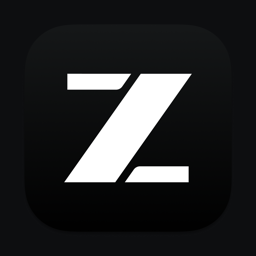

# ZCode for iOS & iPadOS

**Enterprise-grade, 100% Native SwiftUI client for ZCode Remote Control & Agentic Coding Workspaces.**  
Zero `WKWebView`. Native Z.AI OAuth, Relay V4 `HMAC-SHA256` pairing, Binary VQL + CRC32 RPC, Syntax Code & Diff Inspector, `PDFKit` Viewer, and Multi-Agent Orchestration — engineered per Apple Human Interface Guidelines.

<p>
  <a href="https://github.com/leduyphuc1702/zcode-ios/actions"></a>
  
  
  
  
  <a href="LICENSE"></a>
</p>

<p>
  <a href="#-highlights">Highlights</a> •
  <a href="#-visual-tour">Visual Tour</a> •
  <a href="#-architecture--wire-protocol">Architecture & Protocol</a> •
  <a href="#-feature-matrix">Feature Matrix</a> •
  <a href="#-getting-started">Getting Started</a> •
  <a href="#-testing--zero-webkit-audit">Testing & Audit</a>
</p>

</div>

---

## ✨ Highlights

Most mobile wrappers for desktop AI coding tools embed a remote web page inside a `WKWebView`, sacrificing frame pacing, tactile ergonomics, system accessibility, offline resilience, and native document inspection.

**ZCode for iOS & iPadOS** re-implements the entire **ZCode Remote (`v3.16.3`)** experience from the ground up in pure native Apple frameworks (`SwiftUI`, `AuthenticationServices`, `CryptoKit`, `PDFKit`, `AVFoundation`, `Charts`, `LocalAuthentication`, and `Security`):

- **Zero `WebKit` Guarantee** — Verified at both source level and Mach-O binary level (`otool -L`) in CI. Every button, code gutter, diff hunk, PDF page, and popover renders natively at 120Hz ProMotion.
- **Native 2-Step Z.AI Onboarding & Pairing** — Authenticate via system out-of-process `ASWebAuthenticationSession` (`/api/v1/oauth/cli/init` + polling) or Z.AI Access Token, then pair via `https://zcode.z.ai/remote/v4?sid=...&mid=...#<passHash>`, clipboard auto-detection, native `AVFoundation` QR camera, or registered Z.AI computers (`/api/v1/remote/device`).
- **1:1 ZCode Remote Workspace Parity** — Multi-project sidebar, pinned tasks, live streaming reasoning & tool cards, nested **`↑ Steer`** prompt queue while agents are running, `/` capability & `@` context mention popovers, unified **Task / Git / Progress / Goal / Agents** status panel, and a multi-tab **SubAgent Slide-Over Transcript Drawer**.
- **Full Native Coding Inspector** — Browse workspace file trees, inspect syntax-highlighted code with inline line comments (`file:start-end`), review unified or split Git diffs (`+add / -del`) with staging & commits, zoom vector PDFs (`PDFKit`) / diagrams / CSV tables, and run commands in a multi-tab PTY terminal.
- **Apple HIG & Enterprise Security** — Dynamic Type, VoiceOver, Differentiate Without Color, Reduce Motion, hardware iPadOS keyboard shortcuts (`⌘N`, `⌘K`, `⌘,`), Keychain-backed tokens, Face ID / Touch ID app lock, and salted SHA-256 pattern unlock.

---

## 📱 Visual Tour

### 1. Native Z.AI Onboarding, Remote Link Validation & 4-Step Relay Pairing

<table>
  <tr>
    <td width="33%" align="center">
      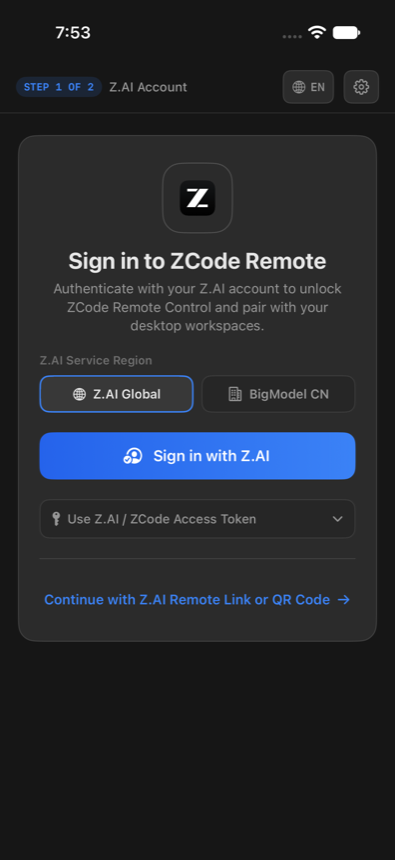
      <br />
      <sub><b>Step 1 — Z.AI Account Login</b><br />Native <code>ASWebAuthenticationSession</code> OAuth (Global &amp; BigModel CN) + Token option</sub>
    </td>
    <td width="33%" align="center">
      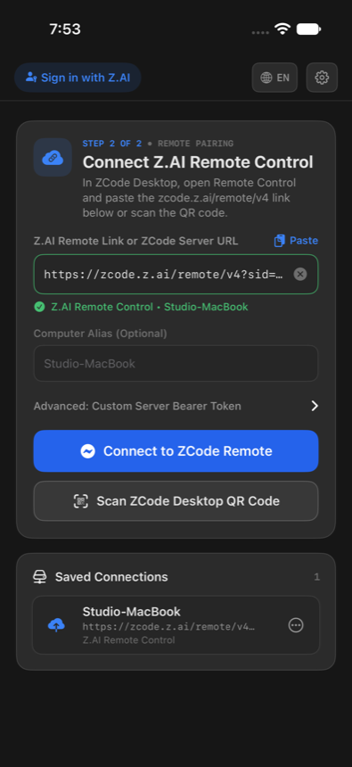
      <br />
      <sub><b>Step 2 — Z.AI Remote Control Link</b><br />Live URL parser, 1-tap Paste, QR Scanner &amp; persisted Saved Connections</sub>
    </td>
    <td width="33%" align="center">
      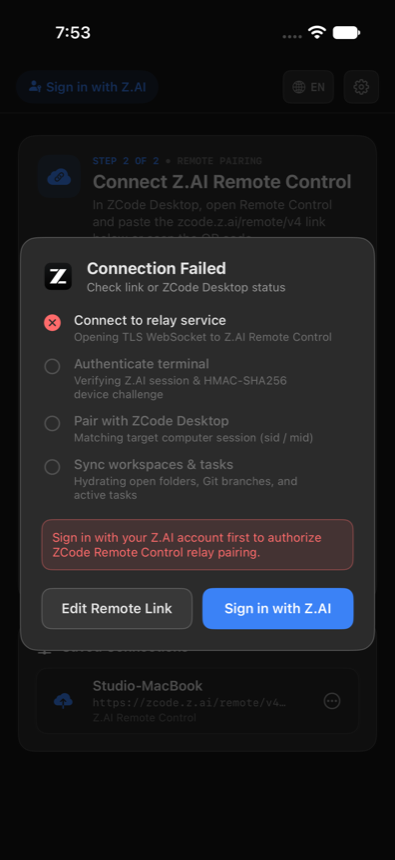
      <br />
      <sub><b>4-Step Relay V4 Handshake</b><br />TLS WebSocket, <code>HMAC-SHA256</code> challenge proof, desktop match &amp; workspace sync</sub>
    </td>
  </tr>
</table>

### 2. 1:1 ZCode Remote Home, Prompt Queue (`↑ Steer`), Slash Popovers & SubAgents

<table>
  <tr>
    <td width="33%" align="center">
      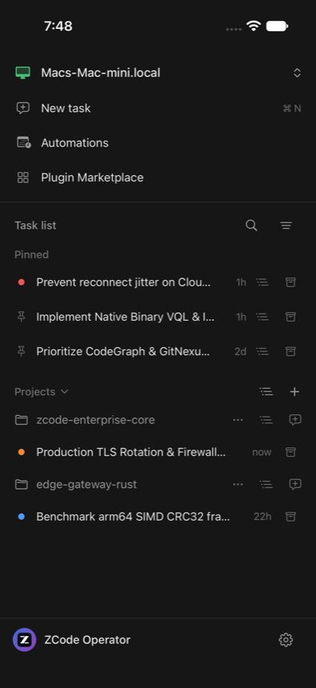
      <br />
      <sub><b>ZCode Remote Home</b><br />Workstation switcher, Pinned tasks, multi-project tree, Automations &amp; Marketplace</sub>
    </td>
    <td width="33%" align="center">
      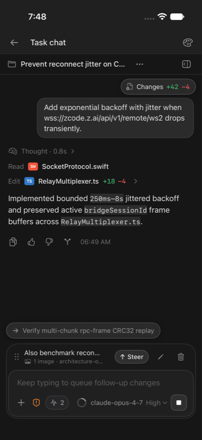
      <br />
      <sub><b>Prompt Queue &amp; Live Steering</b><br />Enqueue follow-ups while running, 1-tap <code>↑ Steer</code>, edit/delete &amp; floating Todo pill</sub>
    </td>
    <td width="33%" align="center">
      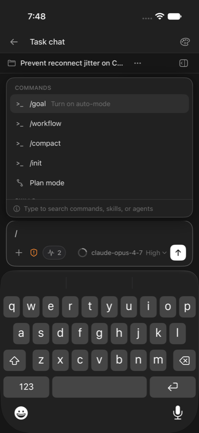
      <br />
      <sub><b><code>/</code> Capabilities &amp; <code>@</code> Mentions</b><br />Instant filtering over <code>/goal</code>, <code>/workflow</code>, <code>/compact</code>, skills, agents &amp; plugins</sub>
    </td>
  </tr>
</table>

### 3. Unified Task Status Bar, Multi-Tab SubAgent Drawer & Native Inspector

<table>
  <tr>
    <td width="33%" align="center">
      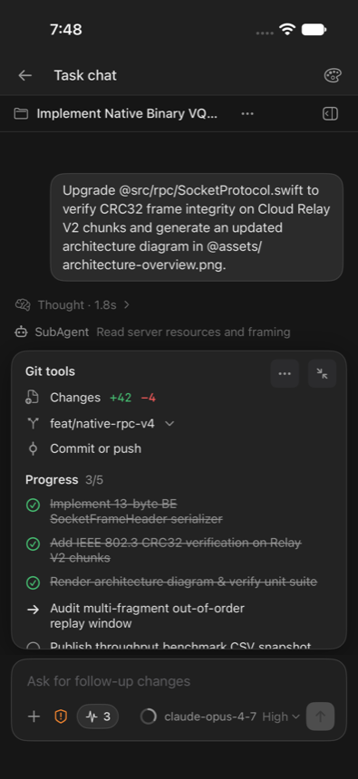
      <br />
      <sub><b>Unified Task Status Panel</b><br />Branch switcher, Git tools, <code>Progress 3/5</code> checklist, Goal timer &amp; running Agents</sub>
    </td>
    <td width="33%" align="center">
      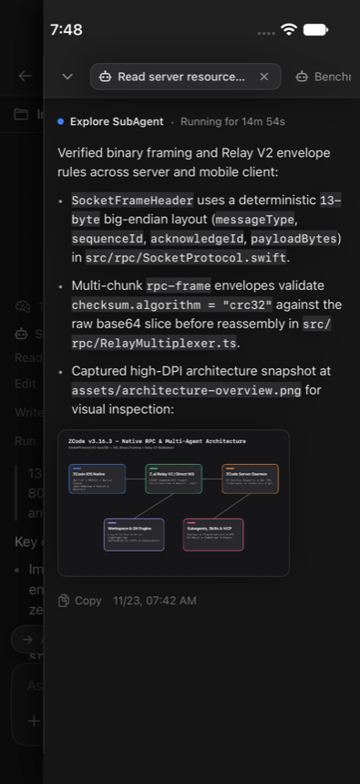
      <br />
      <sub><b>SubAgent Slide-Over Drawer</b><br />Multi-tab background agent transcripts, embedded artifact previews &amp; 1-tap copy</sub>
    </td>
    <td width="33%" align="center">
      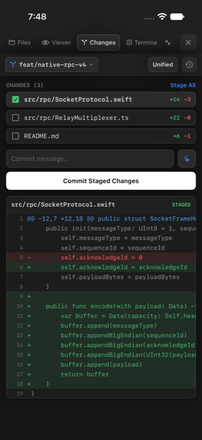
      <br />
      <sub><b>Unified &amp; Split Git Diffs</b><br />Stage/unstage files, inspect line-numbered hunks &amp; commit directly from mobile</sub>
    </td>
  </tr>
</table>

### 4. Syntax Code Gutter, Native `PDFKit` Preview & 1:1 ZCode Settings Hub

<table>
  <tr>
    <td width="33%" align="center">
      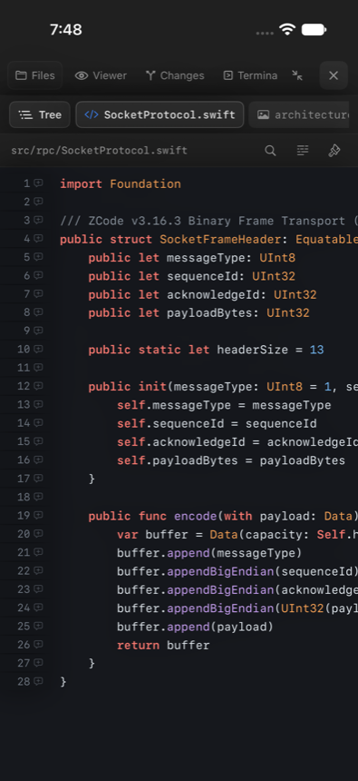
      <br />
      <sub><b>Syntax Code Viewer</b><br />Collapsible file tree, multi-tab open files, line search &amp; inline code comments</sub>
    </td>
    <td width="33%" align="center">
      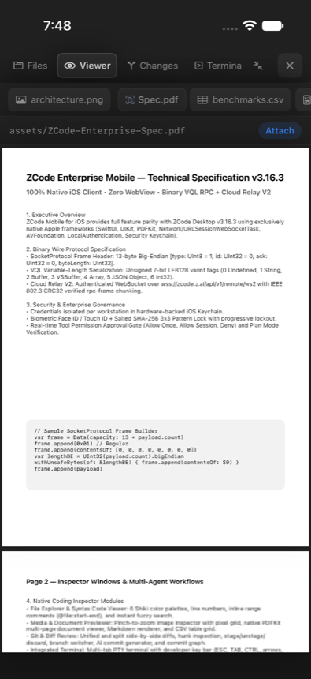
      <br />
      <sub><b>Native Media &amp; <code>PDFKit</code></b><br />Pinch-to-zoom vector PDFs, architecture PNGs &amp; structured CSV benchmark tables</sub>
    </td>
    <td width="33%" align="center">
      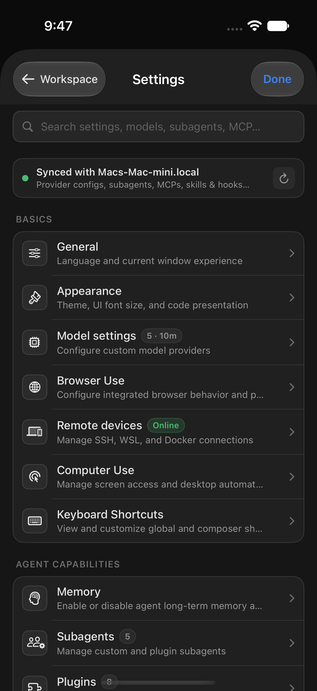
      <br />
      <sub><b>1:1 ZCode Settings Hub</b><br />3 official groups &amp; 16 sections synced live over Desktop VQL RPC</sub>
    </td>
  </tr>
</table>

### 5. 1:1 ZCode Model & Provider Studio and Subagent Studio

<table>
  <tr>
    <td width="33%" align="center">
      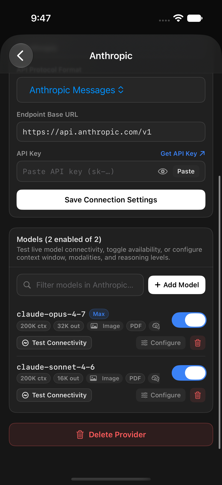
      <br />
      <sub><b>Model &amp; Provider Studio</b><br />17 official templates, Keychain API keys, Base URL &amp; per-model Connectivity Test</sub>
    </td>
    <td width="33%" align="center">
      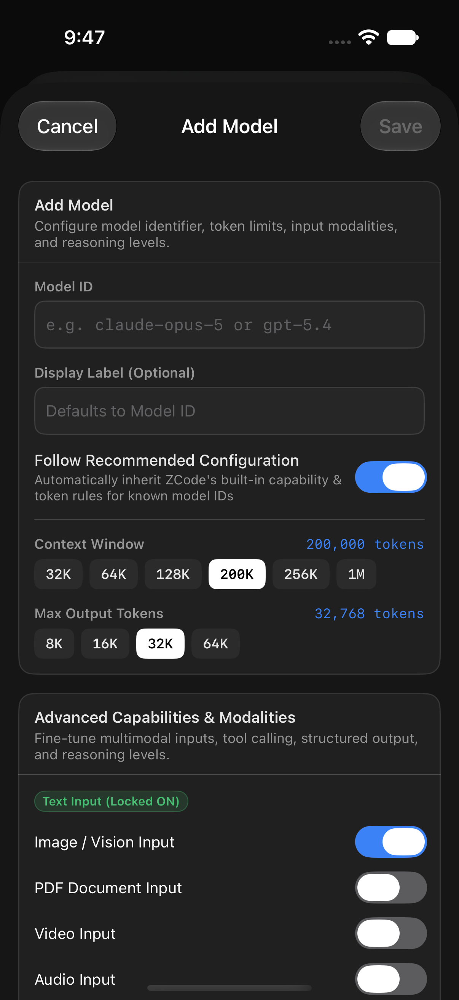
      <br />
      <sub><b>Model Capability Matrix</b><br />Context/Output presets, Multimodal inputs &amp; ordered Reasoning Effort levels</sub>
    </td>
    <td width="33%" align="center">
      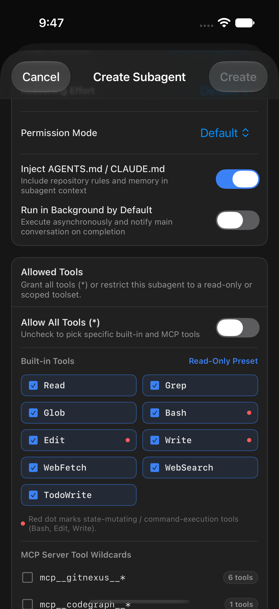
      <br />
      <sub><b>Subagent Studio</b><br />Built-in overrides, custom agents, 9-tool permissions grid &amp; Markdown prompt editor</sub>
    </td>
  </tr>
</table>

---

## 🏗 Architecture & Wire Protocol

ZCode for iOS speaks the exact wire protocols used by **ZCode Desktop** and **Z.AI Remote Control v4**, split cleanly into transport, binary framing, and `@Observable` main-actor state.

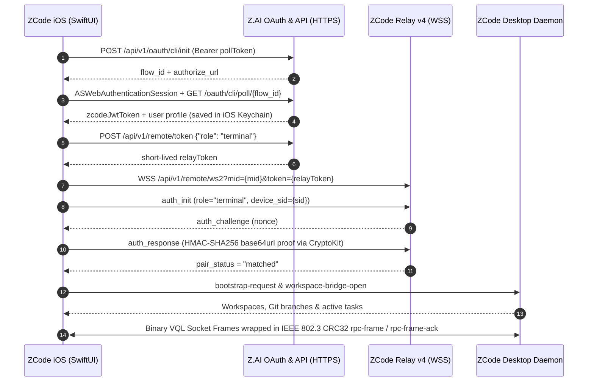

### Binary VQL & Socket Framing (`ZCodeVQLCodec.swift`)

All low-latency RPC invocations (`zcode-task`, `terminalService`, workspace file & diff queries) serialize through a deterministic binary codec compatible with ZCode Server:

| Layer | Specification | Implementation |
| :--- | :--- | :--- |
| **Authentication** | `ASWebAuthenticationSession` + `HMAC<SHA256>` challenge proof | [`ZaiAuthAndRemoteService.swift`](Sources/Networking/ZaiAuthAndRemoteService.swift) |
| **Relay Envelope** | JSON `rpc-frame` + `rpc-frame-ack` with **IEEE 802.3 CRC32** (`0xEDB88320`, check vector `"123456789" -> cbf43926`) | [`ZCodeRPCClient.swift`](Sources/Networking/ZCodeRPCClient.swift) |
| **Socket Header** | 13-byte Big-Endian frame header (`type: UInt8`, `id: UInt32`, `ack: UInt32`, `payloadLength: UInt32`) | [`ZCodeVQLCodec.swift`](Sources/Networking/ZCodeVQLCodec.swift) |
| **Payload Serialization** | Binary VQL tags (`undefined`, `null`, `bool`, `vint`, `double`, `string`, `buffer`, `array`, `object`) | [`ZCodeVQLCodec.swift`](Sources/Networking/ZCodeVQLCodec.swift) |

---

## 🧩 Feature Matrix

| Domain | Capabilities Included | Native Frameworks Used |
| :--- | :--- | :--- |
| **Account & Pairing** | Z.AI OAuth (`Global` & `BigModel CN`), Access Token login, `zcode.z.ai/remote/v4` link parser, Direct `ws://` / `wss://` LAN & Tailscale mode, Camera & Photo Library QR scanner, Saved Connections | `AuthenticationServices`, `CryptoKit`, `AVFoundation`, `PhotosUI`, `CoreImage` |
| **Agent Conversation** | Collapsible reasoning trace, categorized tool execution cards, interactive **Permission Approval** (`Allow Once` / `Allow for Session` / `Deny`), structured **AskUserQuestion** & **Plan Review** gates, Git checkpoint rewind | `SwiftUI`, `Observation` |
| **Composer & Steering** | Multi-line adaptive composer, model & effort selector (`Low` / `Medium` / `High` / `Max`), mode switcher (`Ask` / `Plan` / `Build` / `Auto`), **`↑ Steer`** live prompt queue, `+` / `/` / `@` contextual popovers | `SwiftUI` |
| **Task & SubAgent Management** | Unified floating Task Status Panel (`Git tools`, `Progress`, `Goal` timer, `Agents`), multi-tab slide-over SubAgent transcript viewer with artifact previews | `SwiftUI` |
| **Coding Inspector** | Workspace file tree, syntax-highlighted viewer (`GitHub Dark`, `One Dark Pro`, `Solarized`), line range comments attached to composer, Unified/Split Git diff viewer + commit flow, `PDFKit` / PNG / CSV preview, multi-tab Terminal, Workflow DAG | `PDFKit`, `SwiftUI` |
| **Enterprise & Security** | 1:1 ZCode Settings Hub (3 groups, 16 official sections), Model & Provider Studio (17 templates + connectivity tests), Subagent Studio (Built-in/Plugin overrides + custom agent editor), MCP (Form + JSON), Skills, Plugins, Commands, Hooks, Memory, Token analytics charts, Keychain isolation, Face ID & SHA-256 Pattern Lock | `Security`, `LocalAuthentication`, `Charts` |

---

## 📂 Project Structure

```text
zcode-ios/
├── project.yml                                  # XcodeGen specification (iOS / iPadOS 17.0+, Swift 5.10)
├── Resources/
│   ├── Assets.xcassets/                         # AppIcon & ZCode brand vector/raster assets
│   └── Info.plist                               # Deep-link scheme (zcode://), Camera, Face ID & Launch config
├── Sources/
│   ├── App/
│   │   └── ZCodeMobileApp.swift                 # App entry point & lifecycle hooks
│   ├── DesignSystem/
│   │   └── ZCodeTheme.swift                     # Semantic Dark / Graphite / Light palettes & L10n (EN default)
│   ├── Models/
│   │   └── ZCodeModels.swift                    # Strongly typed domain models, Relay phases & RPC entities
│   ├── Networking/
│   │   ├── ConnectionURLParser.swift            # Parser for zcode.z.ai/remote/v4, zcode://, and ws(s):// URLs
│   │   ├── ZaiAuthAndRemoteService.swift        # Native Z.AI OAuth polling, token verification & HMAC-SHA256 proof
│   │   ├── ZCodeRPCClient.swift                 # URLSessionWebSocketTask Relay V4 & Direct Server duplex client
│   │   └── ZCodeVQLCodec.swift                  # Binary VQL serializer, 13-byte socket frame & IEEE 802.3 CRC32
│   ├── State/
│   │   ├── AppStore.swift                       # Clean zero-demo Production store, Keychain persistence & RPC sync
│   │   └── SeedWorkspaceFactory.swift           # Isolated deterministic fixtures (--uitesting-seed-workspace only)
│   ├── Utilities/
│   │   ├── KeychainStore.swift                  # iOS Security.framework Keychain wrapper & salted SHA-256 hasher
│   │   ├── SyntaxHighlighter.swift              # Native AttributedString code syntax highlighter
│   │   └── SampleAssetGenerator.swift           # In-memory vector PDF/PNG generator for UI test fixtures
│   └── Views/
│       ├── Connections/                         # 2-Step Z.AI Onboarding Hub, Pairing Overlay & Native QR Scanner
│       ├── Sidebar/                             # ZCode Remote Home, Workstation switcher & Project/Task list
│       ├── Chat/                                # AgentChatCanvas, ChatTurnCard, Popovers, Status Panel & SubAgents
│       ├── Inspector/                           # Syntax Code Viewer, Split Git Diff, PDFKit Viewer, Terminal & DAG
│       ├── Common/                              # Root 3-pane adaptive iPad/iPhone shell, Command Center & Marketplace
│       ├── Security/                            # Biometric Face ID & 9-node Pattern Unlock Gate
│       └── Settings/                            # 1:1 ZCode Settings Studio (Models, Subagents, MCP, Skills, Usage)
├── Tests/ZCodeMobileTests/                      # Unit tests (CRC32 vectors, VQL round-trip, URL parser, Zero-Demo init)
└── UITests/ZCodeMobileUITests/                  # Full E2E Simulator test suites (Onboarding + 20-screen Workspace audit)
```

---

## 🚀 Getting Started

### Prerequisites

- **macOS 14.5+** with **Xcode 16.0+**
- **iOS 17.0+** / **iPadOS 17.0+** Simulator or physical device
- Optional: [`xcodegen`](https://github.com/yonaskolb/XcodeGen) (`brew install xcodegen`) if regenerating `ZCodeMobile.xcodeproj` from `project.yml`

### 1. Clone & Open in Xcode

```bash
git clone https://github.com/leduyphuc1702/zcode-ios.git
cd zcode-ios

# Optional: regenerate the Xcode project from project.yml
xcodegen generate

open ZCodeMobile.xcodeproj
```

### 2. Run on iPhone / iPad

1. Select the **`ZCode`** scheme in Xcode.
2. If deploying to a physical iPhone or iPad, open **Signing & Capabilities** and select your Apple Developer Team & unique Bundle Identifier.
3. Press **`⌘R`** to build and run:
   - **Step 1**: Tap **Sign in with Z.AI** (or paste a Z.AI / ZCode Access Token).
   - **Step 2**: On your computer, open **ZCode Desktop → Remote Control**, then scan the QR code or paste the `https://zcode.z.ai/remote/v4?sid=...&mid=...` link to pair instantly.

---

## 🧪 Testing & Zero-WebKit Audit

Production launches are **100% clean (zero demo screens or fake tasks)**. Deterministic workspace fixtures are isolated strictly behind the `--uitesting-seed-workspace` launch flag so both fresh-install onboarding and complex multi-agent UI states are continuously verified.

### Run Unit + E2E Simulator Tests

```bash
xcodebuild test \
  -project ZCodeMobile.xcodeproj \
  -scheme ZCode \
  -destination 'platform=iOS Simulator,name=iPhone 16 Pro'
```

### Verify Zero `WebKit` / `WebView` Linkage

```bash
# 1. Source-level audit
grep -rnE "import WebKit|WKWebView|UIWebView|SFSafariViewController" Sources/

# 2. Mach-O binary framework linkage audit
otool -L path/to/ZCode.app/ZCode | grep -i WebKit # Must return empty
```

---

## 🔒 Security Design

- **Hardware-Backed Credential Storage** — Z.AI JWTs, provider API keys, Direct Server bearer tokens, and salted pattern hashes are stored exclusively in the iOS **Keychain** (`kSecAttrAccessibleAfterFirstUnlockThisDeviceOnly`), never in `UserDefaults`.
- **Out-of-Process OAuth Broker** — Z.AI sign-in uses Apple's system `ASWebAuthenticationSession` (`AuthenticationServices.framework`), isolating browser cookies and credentials from the app process.
- **Cryptographic Relay Pairing** — Relay V4 `auth_challenge` nonces are signed in-memory using `CryptoKit` `HMAC<SHA256>` (`nonce|terminal|deviceSid`) without exposing `passHash` over the wire.
- **Biometric & Pattern Gate** — Optional Face ID / Touch ID (`LocalAuthentication`) and 9-node SHA-256 pattern lock with automatic exponential lockout after 5 failed attempts.

---

## 🙏 Acknowledgments

- Architectural inspiration from [`my-dlq/zcode-mobile-app`](https://github.com/my-dlq/zcode-mobile-app) and the official **ZCode Desktop & Remote Control** protocol.
- Crafted in accordance with the [Apple Human Interface Guidelines](https://developer.apple.com/design/human-interface-guidelines).

## 📄 License

Released under the [MIT License](LICENSE).
